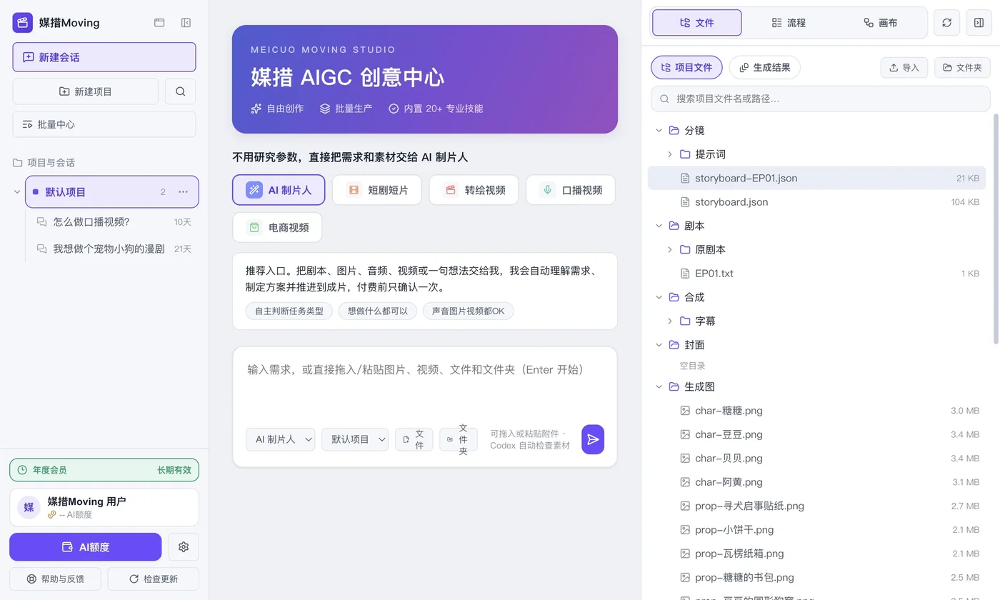

  <a href="https://aitongban.cloud/"><b>官网</b></a> ·
  <a href="https://aitongban.cloud/links#offers">预约咨询</a> ·
  <a href="#产品">产品</a> ·
  <a href="#开源">开源</a> ·
  <a href="https://aitongban.cloud/blog">文章</a> ·
  <a href="mailto:z17362936917@163.com">邮件</a>

我是**朱志勇**，网上叫**月明Verse**。全栈工程师，AI 落地陪跑营主理人。5 年以上 AI 工程经验，自研 AIES 协作开发框架，已在 7 个项目落地。我帮开发者和小团队，把 AI 真正用进开发、产品与内容。

## 我能帮你做什么

| | 能力 | 内容 | 案例 |
| :-- | :-- | :-- | :-- |
| 01 | **AI 原生开发** | 规范与上下文工程、多 Agent 分工、测试验证与质量门禁 | [3 小时交付 10853 行生产代码](https://aitongban.cloud/blog/manage-ai-like-new-employee) |
| 02 | **产品从 0 到 1** | 方向与商业模式、MVP 与技术选型、上线收款与首批用户 | [媒措 Moving](#产品) 已在售 |
| 03 | **AI 助理与知识系统** | 知识库架构、MCP 工具与自动化、消息与工作流闭环 | [用 40 个 MCP 工具搭出知识操作系统](https://aitongban.cloud/blog/tool-dirtywork-ai-intelligent) |
| 04 | **AI 内容生产** | 选题与脚本系统、口播剪辑自动化、数据复盘 | [Moonlit Skills](#moonlit-skills)：27 个内容生产 Skill |

**合作方式**：一对一咨询 ¥399 / 小时 · AI 落地陪跑（按项目）· 知识星球长期交流 → [查看并预约](https://aitongban.cloud/links#offers)

## 产品

**[媒措 Moving](https://aitongban.cloud/projects/moving)** · 在售 · macOS / Windows
把创意做成镜头，再把镜头交出去。从剧本、口播稿或商品图出发，在一个项目里完成讨论、生成、选片与导出。[购买 →](https://buy.aitongban.cloud/moving/)

| 产品 | 状态 | 一句话 |
| :-- | :-- | :-- |
| [CreatorOS](https://creatoros.aitongban.cloud) | Mac 验收中 | 住在本机的抖音编导系统：选题、脚本、发布到数据复盘，一条线跑完。 |
| [AITerm](https://github.com/zzyong24/AITerm) | 开源 · 团队共建 | 终端、编辑器、Git 整合进一个窗口，多项目并行开发。 |
| [ThirdSpace](https://github.com/zzyong24/thirdspace-vault-template) | 开源模板 | Agent 原生的知识库：资料按规则自动归位，任何 AI Agent 都能接手整理。 |
| [Msg-collect](https://msgcollect.aitongban.cloud) | 可用 · 本地部署 | 视频、网页、PDF 转写和提取，交给你自己的模型总结，结果留在本地。 |
| [AI 童伴](https://companion.aitongban.cloud) | 已上线 | 把孩子和 AI 的聊天贴进来，三分钟看出这段对话教得好不好。 |
| [禾安成长日记](https://github.com/zzyong24/hean-growth-journal) | 内测 · 开源 | 喂养、睡眠、日常观察，随手说一句就记下。 |

## 开源

| 项目 | 说明 | |
| :-- | :-- | :-- |
| [ThirdSpace Vault Template](https://github.com/zzyong24/thirdspace-vault-template) | 知识库操作系统模板，Agent 原生、零配置，任意 AI Agent 均可驱动 |  |
| [Hermes OpenClaw Book](https://github.com/zzyong24/hermes-openclaw-book) | AI Agent 架构实战手册：阅读、对照、动手实践 |  |
| [ThirdSpace Dashboard](https://github.com/zzyong24/thirdspace-dashboard) | ThirdSpace 的 Obsidian 可视化控制台插件 |  |
| [AITerm](https://github.com/zzyong24/AITerm) | 多终端管理器，Electron + Vue 的 AI 开发工作区 |  |
| [Skills Judgment](https://github.com/zzyong24/skills-judgment) | Skill 生命周期管理，让技能库随使用自然进化 |  |
| [ThirdSpace（MCP 版）](https://github.com/zzyong24/thirdspace-pub) | 基于 MCP 协议的个人知识管理系统 |  |
| [douyin-im-grabber](https://github.com/zzyong24/douyin-im-grabber) | 抖音群聊全量导出为 JSON / Markdown，同时是一个 Hermes Skill |  |

<b>更多工具与实验</b>

| 项目 | 说明 |
| :-- | :-- |
| [video_cut](https://github.com/zzyong24/video_cut) | 口播视频自动剪辑：本地 Whisper 转录 + AI 口误识别 + 网页审核 |
| [thirdspace-aigc-workbench](https://github.com/zzyong24/thirdspace-aigc-workbench) | AI 视频制作工作台：剧本、三视图、分镜提示词、审片与制作队列 |
| [director-seedance-prompt](https://github.com/zzyong24/director-seedance-prompt) | 导演级电影语言提示词系统，适配 Seedance |
| [grokbot-team-kit](https://github.com/zzyong24/grokbot-team-kit) | 1 总管 + 多专员的 Bot 内容团队：岗位卡、审批规则与工具 |
| [moonos](https://github.com/zzyong24/moonos) | AI 资产主权控制面：可迁移、可治理的记忆、提示词与工作流 |
| [Know-share](https://github.com/zzyong24/Know-share) | 个人 Agent 的知识模块交换与撮合平台 |
| [mkd2pic](https://github.com/zzyong24/mkd2pic) | Markdown 一键转图片 |

## Moonlit Skills

把内容生产里反复使用的方法，做成可独立安装的 Skill，每个 Skill 一个仓库。**[从内容引擎开始 →](https://github.com/zzyong24/moonlit-content-engine)**

| 环节 | Skill |
| :-- | :-- |
| 选题与研究 | [选题雷达](https://github.com/zzyong24/moonlit-topic-radar) · [选题引擎](https://github.com/zzyong24/moonlit-topic-engine) · [对标研究](https://github.com/zzyong24/moonlit-benchmark-research) · [抖音数据萃取](https://github.com/zzyong24/moonlit-douyin-extractor) · [抖音转写](https://github.com/zzyong24/moonlit-douyin-transcribe) · [抖音主播批量转写](https://github.com/zzyong24/moonlit-douyin-anchor-transcribe) |
| 内容与写作 | [内容引擎](https://github.com/zzyong24/moonlit-content-engine) · [商业内容写作](https://github.com/zzyong24/moonlit-business-copywriter) · [去 AI 味](https://github.com/zzyong24/moonlit-de-ai-perception) · [口述成纲](https://github.com/zzyong24/moonlit-oral-to-outline) · [公众号写作](https://github.com/zzyong24/moonlit-wechat-article) · [朋友圈文案](https://github.com/zzyong24/moonlit-wechat-moments) · [X 短帖](https://github.com/zzyong24/moonlit-x-short) · [小红书图文](https://github.com/zzyong24/moonlit-xiaohongshu) |
| 视觉与视频 | [宇航员线稿](https://github.com/zzyong24/moonlit-astronaut-illustration) · [材料信息图](https://github.com/zzyong24/moonlit-material-illustration) · [解说画布](https://github.com/zzyong24/moonlit-explainer-canvas) · [视频脚本](https://github.com/zzyong24/moonlit-video-script) · [HTML 信息视频](https://github.com/zzyong24/moonlit-html-video) · [真人出镜视频](https://github.com/zzyong24/moonlit-talking-head-video) · [数字人视频](https://github.com/zzyong24/moonlit-avatar-video) · [视频封面](https://github.com/zzyong24/moonlit-video-cover) |
| 发布与分发 | [社交图文发布](https://github.com/zzyong24/moonlit-social-publisher) · [四平台视频发布](https://github.com/zzyong24/moonlit-video-publisher) · [公众号排版](https://github.com/zzyong24/moonlit-wechat-publisher) · [抖音封面批量更新](https://github.com/zzyong24/moonlit-douyin-cover-updater) |
| 沉淀方法 | [Skill 设计师](https://github.com/zzyong24/moonlit-skill-creator) |

## 找到我

[官网](https://aitongban.cloud/) · [文章](https://aitongban.cloud/blog) · [抖音](https://www.douyin.com/user/MS4wLjABAAAAZ0Bu__OWbtZcIeDYZ9kLtt8mOGJ7nW9m0w19oj8w4uI) · [B 站](https://space.bilibili.com/431834368) · [小红书](https://www.xiaohongshu.com/user/profile/5fc519460000000001003129) · [X](https://x.com/zhu1894341) · [邮件](mailto:z17362936917@163.com)

让 AI 落地，从能用到可控。 · 朱志勇 · 月明Verse

